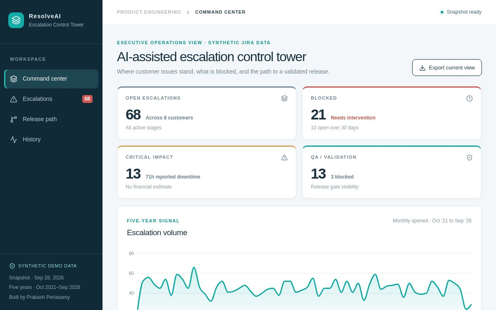

# ResolveAI
### Engineering Escalation Intelligence

**Designed and built by [Prakash Periasamy](https://github.com/prakashperiasamy).**

An engineering escalation decision-support prototype that connects customer impact, evidence, case ownership, blockers, and QA/release handoffs.



## The engineering problem

Customer escalations span support, engineering, QA, and release teams. A ticket list alone makes it difficult to see blocked work, aging exposure, ownership, or the path to a validated resolution.

## What the prototype demonstrates

- **Command center:** open cases, blocked work, critical impact, QA exposure, and monthly history.
- **Escalation queue:** search and filter by severity and workflow stage; inspect case details and event timelines.
- **Release path:** stage-by-stage visibility from intake through customer update.
- **History:** 2,700 fictional cases, including 68 active cases, across eight customers and 60 months.
- **Query assistant:** rule-based questions about blockers, severity, aging, recurrence, customer exposure, and ownership.
- **Exports and drafts:** export filtered records and prepare local workflow drafts.

## Try it in one minute

Open **demo/index.html** in a browser. No installation, account, API key, or internet connection is needed for the dashboard. Download the file first if GitHub shows source text rather than an interactive page. Research links open external websites only when selected.

For a guided demonstration, follow the [five-minute walkthrough](docs/walkthrough.md). The [executive brief](docs/executive-brief.pdf) and [six-slide presentation](docs/presentation.pdf) explain the proposed production architecture. An [interactive brief and deck](docs/executive-brief.html) is also included.

## Run the editable source

Requires **Node.js 22.13 or later** and npm. The first installation needs internet access.

```bash
npm ci
npm run dev
```

Open the local URL printed by Vite. To verify and build:

```bash
npm test
npm run fixtures
npm run build
```

`npm run preview` serves the built application. The source uses React, TypeScript, Vite, Tailwind CSS, Radix UI, and Lucide, plus Recharts for the trend visualization.

## Demo behavior and production design

The dashboard runs entirely in the browser using **synthetic data and deterministic logic**. The query assistant does not call a language model. No Jira, equipment, factory, or customer system is connected. Session actions do not send messages or approve releases. A production design would add governed ingestion, permission-aware retrieval, evaluated AI assistance, durable evidence, and existing engineering approval workflows.

Read the [architecture](docs/architecture.md), [data notes](data/README.md), [evaluation plan](docs/evaluation.md), and [implementation notes](docs/implementation.md).

## Verification

The repository passed **10,849 domain assertions and a server-rendered command center**, offline-artifact checks, TypeScript checking, and a production build. Machine-readable results are in [docs/verification](docs/verification/). These checks establish the listed calculations and rendering paths; they do not measure customer outcomes or replace browser interaction testing. Fresh browser visual/interaction QA was unavailable in this environment. The dashboard image is an existing screenshot of the synthetic prototype, not a screenshot of the rebuilt source.

## Repository guide

| Location | Purpose |
|---|---|
| `src/App.tsx` | Editable dashboard |
| `src/lib/escalations.ts` | Synthetic fixtures and decision/query logic |
| `demo/index.html` | Self-contained offline dashboard |
| `data/` | Reproducible synthetic data export |
| `docs/` | Architecture, walkthrough, executive materials, and verification |
| `scripts/` | Domain checks, render checks, artifact checks, and data export |
| `.github/workflows/verify.yml` | Build and test checks; no deployment |

## Author and use

This portfolio project demonstrates Prakash Periasamy's approach to engineering workflows, data architecture, and AI product design. It is a prototype; production capability and results are proposed rather than claimed. Original code is available for personal evaluation under [LICENSE.txt](LICENSE.txt). Third-party licenses remain in force; see [THIRD_PARTY_NOTICES.md](THIRD_PARTY_NOTICES.md).
