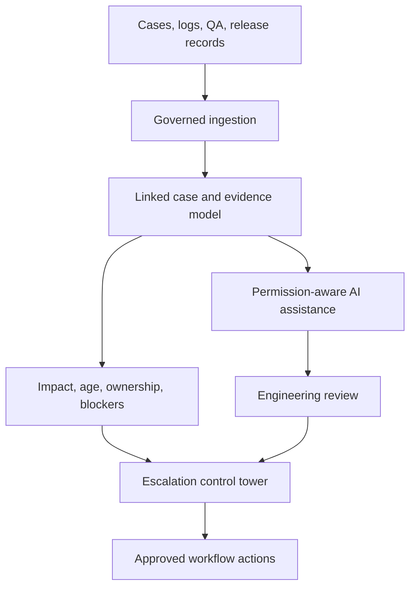

# ResolveAI architecture

## Implemented prototype

The browser renders React components over a deterministic TypeScript model. It generates synthetic fixtures, computes the visible metrics, filters records, and exports local files. The standalone HTML bundles the application and dependencies. The editable source builds with Vite; it needs no server backend, authentication service, database, or model key.

The case model links customer/site/tool context → case → impact → owner → stage/blocker → release → event timeline. Queries operate on the active-case partition and return up to five case references. The history view can search the full case inventory.

## Proposed production architecture

This diagram describes a future implementation. These integrations and AI services are not implemented in the offline prototype.

1. **Systems of record:** ingest approved engineering records without replacing the existing authoritative systems.
2. **Evidence model:** retain record IDs, versions, timestamps, ownership, and permission scopes; distinguish reported impact from validated impact.
3. **Decision services:** keep authoritative calculations deterministic; use a language model for grounded explanations and reviewed proposals.
4. **Engineering controls:** evaluate on held-out evidence; preserve customer access boundaries and an audit trail; require approved workflow actions.
5. **Working surface:** show the evidence behind each result and the owner responsible for the next decision.

## A bounded pilot

Start with one case project and escalation class. In days 0–30, map records and baseline the workflow. In days 31–60, connect a read-only evidence slice and compare prototype recommendations with engineering decisions. In days 61–90, evaluate on held-out examples before approving any action integration. See [evaluation.md](evaluation.md).
